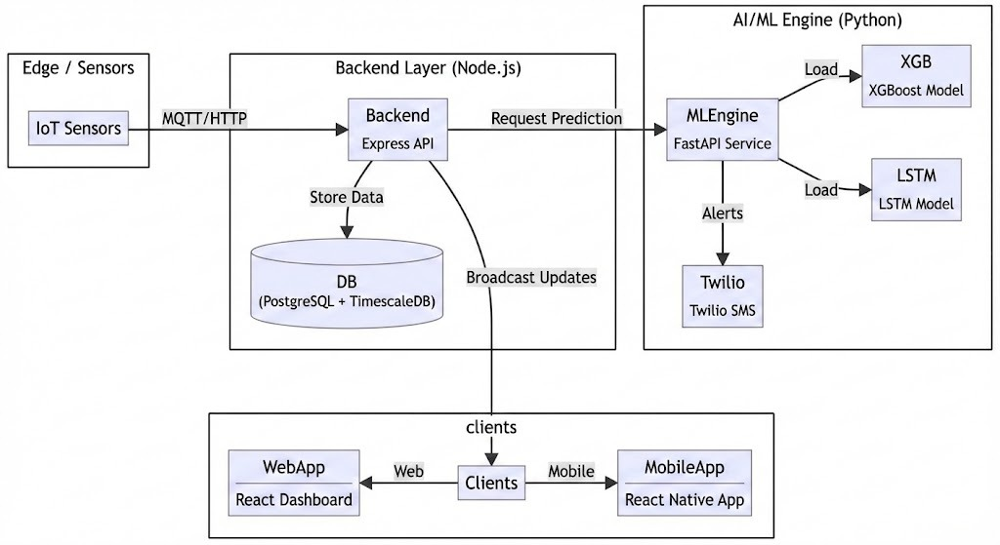
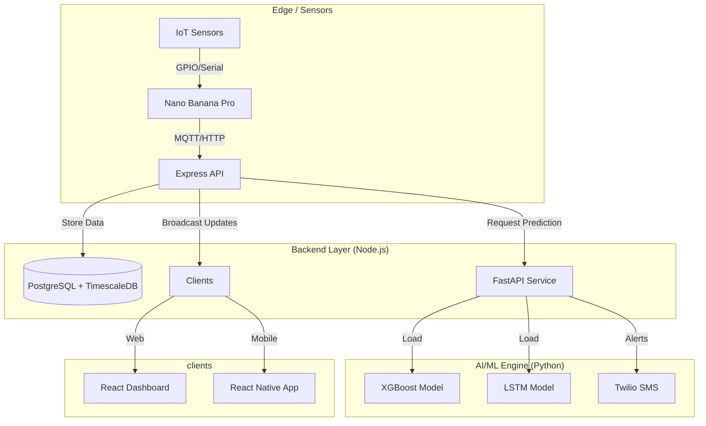

# 🛡️ Rock Shield - Advanced Rockfall Prediction & Monitoring System

Rock Shield is a cutting-edge, AI-driven IoT solution designed to predict and monitor rockfall risks in real-time. By integrating sensor data with advanced machine learning models (XGBoost & LSTM), it provides early warnings and actionable insights to ensure safety in hazardous areas.


## 🚀 Key Functionalities & Uniqueness

- **Real-Time Monitoring**: Live tracking of tilt, vibration, and environmental conditions.
- **AI-Powered Risk Prediction**: Uses an ensemble of **XGBoost** (for feature-based classification) and **LSTM** (for time-series analysis) to calculate accurate risk scores.
- **Multi-Platform Access**: seamless experience across Web (React) and Mobile (React Native/Expo).
- **Instant Alerts**: Integrated Twilio SMS system for immediate "Critical" and "High" risk alerts.
- **Scalable Architecture**: Built on a microservices-inspired architecture with a robust Node.js backend and fast Python ML service.
- **Interactive Maps**: 3D Visualization using Mapbox GL JS for intuitive location monitoring.
- **Multilingual**: This project features multilingual support for Hindi and English, Tamil, Kannad, Marathi and more.

## 🛠️ Tech Stack

### Frontend (Web)

- **Framework**: React (Vite)
- **Styling**: TailwindCSS
- **Maps**: Mapbox GL JS
- **Charts**: Recharts
- **Auth**: Clerk
- **Communication**: Socket.io-client

### Mobile App

- **Framework**: React Native (Expo)
- **Navigation**: Expo Router
- **Auth**: Clerk (Expo)

### Backend

- **Runtime**: Node.js
- **Framework**: Express.js
- **Database**: PostgreSQL (with TimescaleDB support)
- **Real-time**: Socket.io
- **Auth**: Clerk SDK

### AI & Machine Learning

- **API**: FastAPI (Python)
- **Models**: XGBoost, TensorFlow (LSTM)
- **Data Processing**: Numpy, Pandas, Joblib
- **Notifications**: Twilio

---

## 🏗️ System Design

The system follows a modular data flow where IoT sensors transmit data to the **Nano Banana Pro** single-board computer (Edge Node). This device pre-processes readings and pushes data to the backend, which is then processed by the ML Engine for risk assessment. Results are broadcasted to the Web Dashboard and Mobile App in real-time.





---

## ⚙️ Setup & Installation

### Prerequisites

- Node.js (v18+)
- Python (v3.9+)
- PostgreSQL (v14+)

### 1. Database Setup (TimescaleDB)

The project is optimized for time-series data using TimescaleDB.

```sql
-- Enable TimescaleDB extension
CREATE EXTENSION IF NOT EXISTS timescaledb;

-- Convert standard table to hypertable (after running backend initialization)
SELECT create_hypertable('iot_sensor_data', 'measured_at');
```

### 2. Backend Setup

```bash
cd backend
npm install
# Create .env file with your DB credentials and Clerk keys
npm run init-db  # Initialize database tables
npm start
```

### 3. ML Service Setup

```bash
cd ai-ml/ml-service
pip install -r requirements.txt
# Create .env with TWILIO_ACCOUNT_SID, TWILIO_AUTH_TOKEN, etc.
python main.py
```

### 4. Frontend Setup

```bash
cd frontend
npm install
npm run dev
```

### 5. Mobile App Setup

```bash
cd rockshield-mobile
npm install
npx expo start
```

---

### Environment variable templates

Copy the templates below into `.env` (or `.env.example`) files for each service and fill in the real values. Do NOT commit secrets to git — add `.env*` to `.gitignore`.

```bash
# Backend - file: `backend/.env.example`
NODE_ENV=development
PORT=3000

# Postgres (preferred: use DATABASE_URL or the individual settings)
DATABASE_URL=postgres://<user>:<password>@<host>:<port>/<database>
PGHOST=<db_host>
PGPORT=5432
PGUSER=<db_user>
PGPASSWORD=<db_password>
PGDATABASE=<db_name>

# Clerk (Auth)
CLERK_PUBLISHABLE_KEY=<your_clerk_publishable_key>
CLERK_SECRET_KEY=<your_clerk_secret_key>

# JWT / Sessions
SESSION_SECRET=<secure_random_string>
JWT_SECRET=<jwt_secret>

# Twilio (for notifications)
TWILIO_ACCOUNT_SID=<your_twilio_account_sid>
TWILIO_AUTH_TOKEN=<your_twilio_auth_token>
TWILIO_PHONE_NUMBER=<twilio_phone_number>

# ML Service (where backend calls for predictions)
ML_SERVICE_URL=http://localhost:8000
ML_SERVICE_API_KEY=<optional_api_key_if_used>
```

```bash
# ML service - file: `ai-ml/ml-service/.env.example`
PORT=8000
ML_API_KEY=<optional_api_key_for_ml_service>

# Model paths (relative to `ai-ml/ml-service`)
XGBOOST_MODEL_PATH=./Models/xgboost_model.joblib
LSTM_MODEL_PATH=./Models/lstm_model.h5
FEATURE_ORDER_PATH=./Models/feature_order.json
WINDOW_SIZE=64

# Twilio (used by ML service to send alerts)
TWILIO_ACCOUNT_SID=<your_twilio_account_sid>
TWILIO_AUTH_TOKEN=<your_twilio_auth_token>
TWILIO_PHONE_NUMBER=<twilio_phone_number>
```

```bash
# Frontend - file: `frontend/.env` (Vite expects `VITE_` prefix for exposed vars)
VITE_API_URL=http://localhost:3000/api
VITE_CLERK_PUBLISHABLE_KEY=<your_clerk_publishable_key>
VITE_MAPBOX_TOKEN=<your_mapbox_token>
```

```bash
# Mobile (Expo) - file: `rockshield-mobile/.env`
EXPO_PUBLIC_API_URL=https://your-backend.example.com
EXPO_PUBLIC_CLERK_PUBLISHABLE_KEY=<your_clerk_publishable_key>
```

Remember: never commit files containing secrets. Add `.env*` to your repository's `.gitignore`.

---

## 🔮 Future Plans: Edge Computing

We are actively working on moving inference closer to the source:

- **TinyML**: Deploying quantized TFLite models directly on ESP32/microcontrollers.
- **Latency Reduction**: Minimize network dependency by processing critical alerts locally on the edge device.
- **Hybrid Mode**: Edge for immediate safety cutoffs, Cloud for long-term trend analysis.

---

## 📸 More Screenshots

|                                               Mobile Alert                                               |                            Dashboard Detail                             |
| :------------------------------------------------------------------------------------------------------: | :---------------------------------------------------------------------: |
|  |  |

## Acknowledgements

- **Libraries**: Mapbox, Recharts, Clerk, Expo, FastAPI, TensorFlow, XGBoost.
- **Data**: Geological survey datasets for training rockfall models.
- **Collaborators**: The entire Rock Shield development team.
